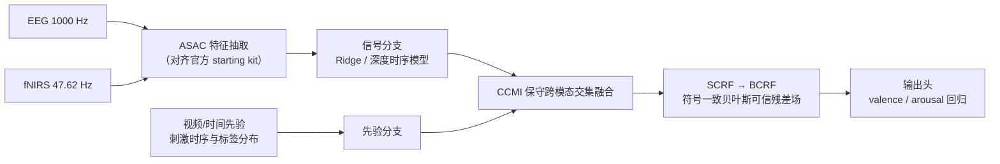

<div align="center">

# bci-mer

**Continuous valence–arousal regression from EEG + fNIRS, with an honest account of where the signal actually comes from.**

MER-PS 2026 多模态情绪识别：EEG + fNIRS 连续情绪轨迹预测，官方主指标 overall MAE。

[](#快速开始--quick-start)
[](https://zeroqiaoba.github.io/MER-Challenge/)
[](#结果--results)
[](#)

</div>

---

## 赛题 / Task

MER-PS 要求根据同步采集的 **EEG（1000 Hz）** 与 **fNIRS（47.62 Hz）**，预测被试观看情绪诱发视频过程中每秒的连续情绪状态：

| 项目 | 内容 |
|---|---|
| 输入 | EEG + fNIRS |
| 输出 | `sample_id, valence, arousal` |
| 标签频率 | 1 Hz |
| 标签尺度 | `[1, 255]` 原始整数尺度，`(128, 128)` 为价-唤醒平面中心 |
| 主指标 | overall MAE（越低越好） |
| 划分 | subject-disjoint |
| 提交 | Codabench code submission |

数据划分严格按被试隔离：train 为 `test_1–test_20`（30,720 样本），validation 为 `test_21–test_24`（6,144 样本）。隐藏测试集全程不可见。

---

## 结果 / Results

| 方案 | overall MAE | valence MAE | arousal MAE |
|---|---|---|---|
| **`222_BCRF_onSCRF`（当前最优）** | **28.6868** | 26.8958 | 30.4777 |
| `CCMI PriorSlopeGate`（最佳 EEG+fNIRS 信号融合） | 28.7145 | — | — |
| `333_PCAEarlyDirectRidge`（**无视频/时间先验**的纯信号模型） | 47.0764 | — | — |

实验规模：**316 个迭代编号、181 份结果 JSON、2231 行聚合记录**。

### 一个必须写清楚的结论

纯生理信号模型（47.08）与带视频/时间先验的模型（28.69）差了 **18 个 MAE 点**。这说明该赛题上**大部分可解释方差来自刺激时序而非生理信号本身**——时间先验泄漏进模型，分数会好看，但"从脑信号读出情绪"这件事并没有被证明。

因此本项目把两条线分开报告：

- **信号能力线**：只用 EEG + fNIRS（47.08），这是真实的生理可解码性；
- **竞赛排名线**：允许视频/时间先验（28.69），这是赛题框架下的最优解。

> 混合报告这两条线是最常见的自欺方式。分开写，结论才站得住。

---

## 方法 / Approach



| 模块 | 作用 |
|---|---|
| **ASAC 特征** | 对齐官方 starting kit 的特征抽取，保证与排行榜口径一致 |
| **CCMI**（保守跨模态交集） | EEG 与 fNIRS 的可靠区域取交集再融合，避免单模态噪声被放大 |
| **CRF-Fusion** | 可信残差融合：先验给出基座预测，信号分支只修正有把握的残差 |
| **SCRF / BCRF** | 符号一致贝叶斯可信残差场：对残差施加符号一致性与可信度门控 |
| **多教师蒸馏** | CBraMod-MTDP 风格的跨模态蒸馏，把大模型表征压到轻量学生模型 |
| **视频先验 222** | 刺激时序先验的消融版本，用于量化先验贡献 |

实验演进、模块清单与论文映射见 `mer_ps/MODULE_INVENTORY_AND_PAPER_MAP.md` 与 `mer_ps/MER_PS_strategy_report_outline.md`。

---

## 目录结构 / Layout

```
bci-mer/
├── mer_ps/                        # 赛题工作区
│   ├── emotion_merps/             # 核心库：model / features / distill / graph_mamba
│   ├── tools/                     # 交叉验证策略、提交构建、先验模块、图表生成
│   ├── submissions/               # 各被试与方案提交包（sub4–sub9、video_prior_222_bcrf）
│   ├── experiments/ configs/      # 实验配置与中间产物
│   ├── assets/                    # 图表与汇报素材
│   └── *.md                       # 策略复盘、文献综述、结果记录
└── README.md
```

数据（`data/`）、模型权重与实验输出不入库。

## 快速开始 / Quick Start

```bash
git clone https://github.com/periodgod/bci-mer.git
cd bci-mer/mer_ps
pip install numpy scipy scikit-learn xgboost lightgbm torch

python train_baseline.py     # 官方基线复现
python train_distill.py      # 多教师蒸馏
```

提交前用 `tools/validate_predictions.py` 校验格式：`sample_id, valence, arousal` 三列、1 Hz、`[1,255]` 整数尺度。

## 文档 / Docs

- `mer_ps/README.md` — 赛题定义、数据细节、复现进度
- `mer_ps/TEST_RESULTS.md` — 首轮算法迭代与指标
- `mer_ps/MER_PS_strategy_report_outline.md` — 策略复盘（当前最优与演进路径）
- `mer_ps/PAPER_MODULE_SCRF_BCRF.md` — 核心模块的形式化描述
- `mer_ps/NO_VIDEO_PRIOR_SIGNAL_RESULTS.md` — 纯生理信号结果（诚实基线）

## 在项目群中的位置

特征缓存格式、划分协议与指标计算复用 [bci-bench](https://github.com/periodgod/bci-bench)；多模态时序建模经验延伸到 [bci-foundation-model](https://github.com/periodgod/bci-foundation-model) 的联合预训练设计。

---

<div align="center"><sub>MER Challenge 2026 · MER-PS Track　|　竞赛数据受官方协议约束，不随仓库分发</sub></div>
